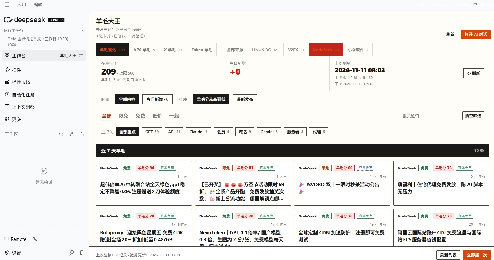

# 羊毛大王

一个 DSH Desktop 工作台：把「哪个平台还免费」「额度多少」「要不要绑卡」「会不会休眠」这类
到处散落、过一阵就过期的信息，变成**能刷新、能筛选、能记笔记**的一页。

五个页面各管一件事：六个站点的羊毛流、Epic 每周免费游戏、自己的云资源卡片库、X 上的热帖、一个只看不动的外部榜单。



---

## 羊毛雷达

六个站点的羊毛帖汇总，打开就有东西看。

- **来源**：LINUX DO 福利羊毛、NodeSeek、V2EX 优惠信息、小众软件、果核剥壳、异次元软件世界
- **羊毛分**：按「是否真免费、有没有具体额度、是否要绑卡/实名、新旧程度」自动打分，默认**按分数从高到低**排，一屏先看最值得动的
- **核实结论**：每条都标出「真实免费 / 有条件免费 / 只是优惠 / 待判断」，不用点进去猜
- **标签**：限免 / 免费 / 低价 / 一般（这是价格维度，和「是不是游戏」无关）
- **筛选**：按来源分段、按标签、按重点词（GPT、Claude、VPS、会员、API…）、按关键词搜索、按「今日新增」
- **排序**：默认羊毛分，也可以切「最新发布」纯按时间倒序
- **AI 帮领**：每张卡片都有这个按钮，点一下生成一段领取指令——粘到 AI 对话里，Agent 会先读原帖、再打开落地页，按页面要求领取；遇到登录、验证码、绑卡、付费会停下来问你（它不碰密码，也不替你付款）
- **自动刷新可配置**：雷达页有一排「定时刷新」——开关、时间点（默认 8,12,16,20）、保留天数，改完**立刻生效**，不用重启
  - 关机或睡眠错过的时段，开机后会补跑一次（6 小时内）
  - 旁边能看「下次什么时候跑」和**最近 20 次运行记录**（时间 / 定时还是手动 / 抓到几条 / 耗时 / 卡在哪个源）
  - 空闲时界面也会自动同步：定时任务跑完，列表自己就更新
- 只留近 N 天（默认 7 天），在库最多 500 条
- 六个来源直连；哪个源被 Cloudflare 挡成 403，就自动改用你的浏览器再抓一次（用的是你 Chrome 的登录态与网络）

## 游戏限免

Epic 每周送的游戏单独占一页——它和「免费/限免」不是一个维度：一个是价格状态，一个是内容类型，而且**有明确截止时间**。

- **按截止时间从近到远排**：最先到期的最上面，提醒你该领了
- 每条显示「还剩 N 天截止」，**两天内标红**；过期自动下版，不留无效条目
- 点标题或「去领取 →」直接到商店页；领取后永久入库，过期就没了
- **这一页故意不提供「AI 代领」**：游戏领取会在店铺账号上产生订单记录，风险高于收益，留给你自己点
- 与雷达共用同一次抓取和同一个刷新入口（页面右下角「立即抓一次」）
- 空页面会说明：Epic 每周四换一批；若一直为空，去雷达页看「上次刷新」下面有没有 Epic 的失败原因


## VPS 羊毛

自己的卡片库：把真正在用的云资源整理成卡片，而不是散在聊天记录里。

- **今日重点**：高优先级、评分高、已核实的排在最前，打开就知道先动哪个
- **一张卡片包含**：核心要点、带数字的额度与规格、优点、坑点与提醒、适用场景评分与理由、核实日期、来源链接、注册条件、下一步建议
- **筛选**：分类、核实状态（已确认／待验证）、处理标记、最低评分，外加全文搜索（标题、要点、额度、坑点、来源都能搜）
- **我自己的部分**：备注与处理标记直接写在卡片里，改完自动保存
- **一键复核**：生成一段结构化的复核指令并复制到剪贴板，交给 AI 对话去联网核实；它把结果写回后，回到这里点「刷新」就生效

首次打开自带一批已核实的示例卡片，可以直接改成自己的。

## X 羊毛

X 上「羊毛」「薅」的最新热帖榜。

- 保留最新 **200 条**，按发布时间从近到远排，刷到的是「刚刚在发什么」，不是三天前的
- 每条显示作者、@handle、点赞、转发、回复、发布时间
- 「立即抓 200 条」随时手动刷新；「让 AI 搜」是在浏览器通道不可用时的兜底
- 用你 Chrome 已登录的会话抓取，工作台自己**不保存任何 cookie 或 token**

## Token 羊毛

把 [aihot.news/free-tokens](https://aihot.news/free-tokens) 只读地嵌进来，不用来回切浏览器。

- 页面里的领取链接、规则都以源站为准
- 想在新窗口看，点右上角「在新窗口打开」
- 内容缓存 5 分钟，点「刷新羊毛页」会强制重新取

---

## 第一次用，三步

1. **打开**：展开左侧栏，在「工作台」右侧的切换区域选「羊毛大王」。
2. **抓一次**：在「羊毛雷达」点「↻ 刷新」，几十秒后就能看到四站汇总；「X 羊毛」点「立即抓 200 条」同理。
3. **跟进**：挑中哪条，就在「VPS 羊毛」里整理成卡片——写备注、改处理标记（待试用／持续关注／已采用／已排除），
   需要核实时点「一键复核最新信息」，把生成的指令粘到 AI 对话里发出去。

## 刷新的时候会看到什么

抓取要几十秒到一两分钟，所以点下去之后：

- 按钮立刻变成「抓取中 12s…」，秒数每秒走一格
- 结束后提示条会写清楚：**用时多少秒、这一轮抓到多少条、各来源各多少条、在库里一共多少条**
- 「上次刷新」下面还会**常驻一行**上次结果；如果失败了，失败原因也常驻在那里，不会随时间消失

## 安装

从 [Releases](https://github.com/ttttstc/dsh-workbench-intel-center/releases) 下载
`dsh-workbench-intel-center.tgz`，然后：

1. DSH Desktop → 工作台管理 → 安装本地包，选择该 `.tgz`
2. 按提示重启 Harness
3. 展开左侧栏，在「工作台」右侧的切换区域选择「羊毛大王」

## 常见问题

**抓取失败 / 只抓到一部分？**
七个来源里只有 LINUX DO 常被 Cloudflare 挡，需要借浏览器的登录态补抓（走 web-access 的 CDP 代理，默认
`localhost:3456`）；NodeSeek 有官方 RSS，直连就能取。哪个来源失败会写在提示条里，其余来源照常入库。

**X 一条都没抓到？**
同样需要 Chrome 已登录并开启远程调试、CDP 代理在运行。临时办法是点「让 AI 搜」，把生成的指令交给会话去抓。

**顶部出现「服务端还是旧版本」？**
这是升级后的正常提示：界面已经换新，但服务端要等 Harness 重启才用新代码。用菜单
「Harness → 重启 Harness」，重启后横幅消失即可。

**数据存在哪？卸载会丢吗？**
存在本机 DSH 数据目录下的 `intel-center/` 里，卸载工作台不会删除它。

---

## 开发与文档

```bash
npm run verify   # 构建客户端产物 + 跑全部测试 + 包校验
```

设计取舍、状态机清单与接口说明见 [`docs/state-machines.md`](docs/state-machines.md)。
